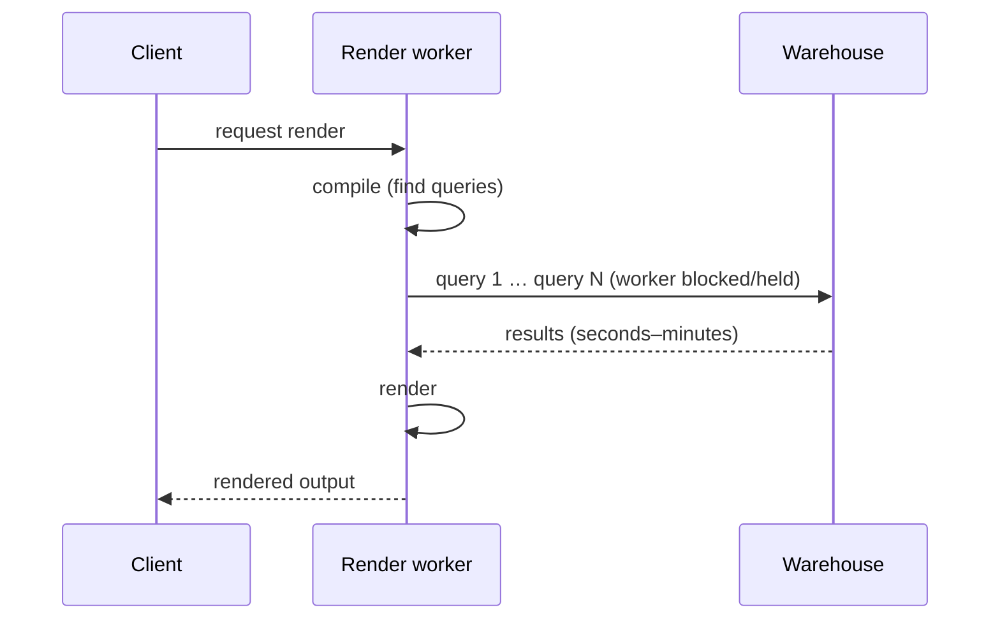
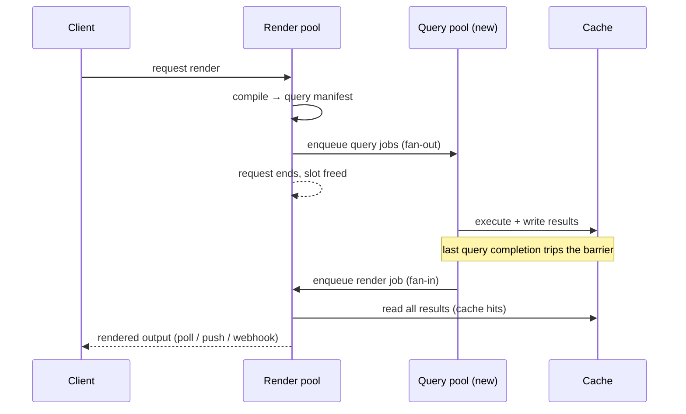

# Spike: Separating Query Execution from Render

**Status:** research spike · **Author:** Claude (for Dave) · **Date:** 2026-08-20

> **Scope caveat:** this session couldn't attach the `fivetran/dataface` codebase (cross-org repo adds aren't supported from a session rooted in a personal repo), so this doc is grounded in the architecture as described — renders currently execute their queries inline, and there's an existing queue/pool system — plus how this exact split is done in comparable systems. Everything code-dependent is flagged with **[verify]** and collected into a checklist at the end. Re-running this spike in a session rooted on `fivetran/dataface` would let the estimates be confirmed against real code.

---

## TL;DR

**Not crazy — it's a good idea, and a standard one.** Decoupling "run the queries" from "render the result" via a job queue is the pattern most mature BI/reporting systems converge on (Looker's async query workers, Superset's async queries + results backend, Metabase's scheduled cache warming). The architecture you described — render request compiles, enqueues query jobs into a dedicated pool, ends; the render job fires only once all results are in cache — is a textbook fan-out/fan-in with a completion barrier, and the queue infrastructure you already run for pools covers most of the plumbing.

**How much it saves depends on one ratio:** the fraction of a render worker's wall-time spent *waiting on queries* versus actually rendering, weighted by how expensive a render slot is. If query time dominates (it usually does — warehouse queries run seconds-to-minutes while renders take a few hundred ms to a few seconds), render-pool occupancy drops by roughly that fraction — often **80–95%** of render-slot-seconds. Whether that translates into big *dollar* savings depends on whether render slots are expensive (memory-heavy processes, headless browsers, billed instance-time) or cheap (async I/O handlers that idle at near-zero cost). Measure that ratio first — it's a few log lines — before committing.

**Effort:** with the queue/pool system already in place and a query-result cache already existing, the MVP is roughly **1–2 engineer-weeks**, plus 1–2 more for dedup, observability, and rollout hardening. The single biggest feasibility risk is whether the compile stage can enumerate *all* of a render's queries up front without actually rendering — if queries are discovered lazily mid-render, add a week+ to build a query-manifest pass. **[verify]**

**The extreme version — native async warehouse APIs (§6) — is less extreme than it sounds.** It's a v2 of the query pool's internals, not a different architecture: the job submits to the warehouse's own job API, persists the handle, and releases the worker; a poller completes it later. The big five warehouses all have first-class job APIs (BigQuery is *natively* job-based), and Airflow's deferrable operators are large-scale prior art for exactly this pattern. Its main prize is reliability and unbounded in-flight scale rather than compute — phase 1 already captures most of the compute win — so build phase 1 with a driver interface that leaves room for it, then add async adapters warehouse-by-warehouse.

---

## 1. Current vs. proposed

### Today (as described)



One render worker holds its slot for `T_compile + T_queries + T_render`. The expensive resource (the render slot) is occupied for the full duration even though most of that time is spent waiting on warehouse I/O.

### Proposed



The render pool is only occupied for `T_compile` (front) and `T_render` (back). All the waiting moves into a query pool sized and priced for waiting.

---

## 2. Why this works (and when it doesn't)

The gain comes from matching each workload to a resource shaped for it:

- **Query execution is I/O-bound waiting.** A worker running a warehouse query is ~idle: it holds a connection and waits. These jobs can be packed densely — dozens or hundreds per cheap async worker — and governed with per-warehouse concurrency caps so one tenant's slow warehouse can't starve anyone.
- **Rendering is short and (relatively) resource-heavy.** Whatever a render slot costs — memory for the app runtime, a headless browser for PDF/image output, CPU for layout — you now pay it only for the seconds rendering actually takes.
- **Decoupling kills head-of-line blocking.** Today, a burst of renders against a slow warehouse pins the whole render pool; everything else queues behind them. Split, slow queries pile up harmlessly in the query pool while renders whose data is ready flow through.

Secondary wins that come along for nearly free:

- **In-flight query dedup.** Concurrent renders of the same dashboard (or dashboards sharing queries) currently each run the query. With a queue keyed by query hash, N waiting renders subscribe to one execution. In shared-dashboard-heavy usage this alone can cut warehouse load noticeably.
- **Cache-first fast path.** A render whose queries are all cached skips the queue entirely and renders immediately — the split makes the cache a first-class contract instead of an optimization.
- **Query-granular retries and timeouts.** A failed query retries alone; today it likely kills or stalls the whole render. **[verify]**
- **Prioritization.** Interactive renders can outrank scheduled/report renders in the query queue.
- **Cache pre-warming becomes trivial:** the "run queries → fill cache" half is exactly what a scheduled warmer needs; the render half just finds hits.

### When the savings are small

Honest counter-case: if renders are handled by an async runtime (e.g. Node awaiting query promises) with a small memory footprint, a render "blocked" on queries costs little CPU — the savings are then mostly *operational* (isolation, QoS, dedup, no head-of-line blocking) rather than raw compute. The savings are large when any of these hold:

1. Render workers are **processes/containers with real memory footprints** (worse: headless Chrome for PDFs/screenshots). **[verify]**
2. Compute is billed by **instance-time or request-duration** (Cloud Run, Lambda, autoscaled pods scaled on open requests). Long-open requests are exactly what those bills are made of. **[verify]**
3. The render pool has a **fixed concurrency** that queries currently exhaust — then the split converts directly into either fewer instances or more throughput. **[verify]**

---

## 3. The savings model — put numbers on it

Let, per render:

- `T_c` = compile time, `T_q` = wall-time of the query phase (max over parallel queries, or sum if serial today — **[verify]** which), `T_r` = render time.

**Render-slot-seconds saved per render:** today `T_c + T_q + T_r`; after, `T_c + T_r`. Reduction factor:

```
savings = T_q / (T_c + T_q + T_r)
```

| Scenario | T_c | T_q | T_r | Render-pool reduction |
|---|---|---|---|---|
| Fast cached-ish dashboards | 0.2s | 2s | 1s | ~63% |
| Typical warehouse dashboard | 0.5s | 20s | 2s | ~89% |
| Heavy scheduled report / PDF | 1s | 120s | 5s | ~95% |

Against that, the new query pool costs almost nothing per job (a connection + negligible CPU), and coordination adds a few queue hops (~tens of ms each, plus worker pickup latency — see risks).

**Net compute saved ≈ (render-slot cost/sec × T_q per render × renders/day) − (query-worker cost, small) − (coordination overhead, small).**

### Measure before building (½ day of work)

Add three timing log lines around the existing render path: `t_compile`, `t_queries`, `t_render`, plus render-worker memory footprint and count. A week of data answers "big or little?" definitively. If `T_q` is under ~30–40% of wall-time or render slots are cheap async handlers, deprioritize; if it looks like the table above, the case makes itself.

---

## 4. Design sketch

State machine per render request (a row in the DB or a key in Redis):

```
PENDING_QUERIES ──(last query lands in cache)──▶ READY ──▶ RENDERING ──▶ DONE
       │                                                        │
       └────────────(query failed terminally / timeout)──▶ FAILED
```

1. **Compile step (in the request handler or a cheap job):** compile the doc/dashboard → list of `(query_hash, sql, connection, params)`. Check the cache; enqueue jobs only for misses. If zero misses → enqueue the render job immediately (fast path). Store `pending_count`.
2. **Query pool:** a new job type on the existing queue system, its own worker pool, per-warehouse concurrency caps. Each job: execute → write result to cache under `query_hash` → atomically decrement the parent render's `pending_count` (Redis `DECR` or `UPDATE … RETURNING`). Whoever decrements to zero enqueues the render job. This atomic-decrement barrier is the entire fan-in mechanism — no polling. (If the queue framework has flows/chords/groups — BullMQ flows, Celery chords, Temporal, pg-boss — use that instead of hand-rolling. **[verify]** which framework the pool system uses.)
3. **Dedup:** before enqueueing a query, `SETNX inflight:{query_hash}`. If already in flight, just register this render as a waiter (increment a waiter set; completion decrements every waiter's count).
4. **Render job:** re-check the cache for every query first (results may have been evicted between completion and pickup). Any missing → re-enqueue those queries, flip back to `PENDING_QUERIES`, exit. This re-check makes the whole pipeline idempotent and self-healing — crashes and evictions just cause a retry, never a corrupt render.
5. **Delivering the result:** the original HTTP request ended at step 1, so the client needs poll (`GET /renders/:id`), SSE/WebSocket push, or webhook. For scheduled reports/exports fire-and-forget is natural. For interactive views, keep a *lightweight* waiter (SSE connection on a cheap frontend process) — the point is the heavy render slot isn't the thing waiting. **[verify]** what consumes renders today.
6. **Watchdog:** renders stuck in `PENDING_QUERIES` past a deadline → `FAILED` with which queries hung. Otherwise a lost query job orphans the render silently.
7. **Rollout:** feature flag routing between inline (old) and split (new) paths per org/doc-type; ship scheduled reports first (latency-insensitive, longest queries — biggest win, lowest risk), interactive renders after the latency numbers look good.

---

## 5. Risks & gotchas

- **Lazy query discovery is the feasibility linchpin.** If components discover their queries during render (render → component asks for data → query fires), there's no manifest to fan out. Then you need a "dry-run compile" that extracts the full query list without rendering — this exists cleanly in some architectures and is a real project in others. **[verify]** whether the compiler stage already yields the complete query set.
- **Dependent queries.** Query B templated on the results of query A breaks single-phase fan-out; needs staged waves (fan-out per dependency level) or an inline fallback for those docs. **[verify]** whether this exists in dataface.
- **Added latency on interactive renders.** Two queue hops + worker pickup add ~100ms–1s+ of latency even when queries are fast. The cache-hit fast path (skip the queue entirely) mitigates the common case; measure P50 pickup latency on the existing pool before promising anything. **[verify]**
- **Result-set size vs. cache.** The cache must hold *complete* results between execution and render — big extracts may exceed row/byte limits; today a render might stream them. Need size caps with an inline-fallback or spill-to-object-storage path. **[verify]** current cache backend and limits.
- **Cache keying and security.** Results must be keyed by `(query, params, connection, and the permission context)` — row-level security or per-user connections mean one user's cached result must never serve another's render. If the cache already exists, this is presumably solved, but the split makes the cache load-bearing rather than best-effort. **[verify]**
- **Partial failure UX.** One query of nine fails: render with an error placeholder in that panel, or fail the render? (Recommend: render with placeholders for interactive, fail scheduled exports.) Decide before building the barrier — it changes the terminal-state logic.
- **Two pools to operate.** Sizing, alerting, and a new class of incident ("queries done but render never fired"). The watchdog + a small `renders by state` dashboard covers most of it, but it's real operational surface.

None of these is a stop-sign; they're the standard costs of this pattern, and every mature BI system has paid them and kept the trade.

---

## 6. The extreme version: native async warehouse drivers

Phase 1 still has *someone* waiting on each query — a cheap query worker holding a driver connection. The extreme version removes even that: submit the query through the warehouse's own asynchronous job API, persist the job handle, release the worker entirely, and let a small poller complete the job when the warehouse says it's done.

### It's the same architecture, one layer deeper

Nothing about §4 changes — compile, fan-out, barrier, cache, render trigger are all identical. Only the query job's internals change, from a blocking call to a small state machine:

```
SUBMITTED ──▶ POLLING ──▶ FETCHING ──▶ CACHED ──▶ (decrement barrier)
     └──────────── error / timeout ────────▶ FAILED
```

The job runs in three short worker touches (submit ~100ms, poll checks ~10ms each, fetch) instead of one long-held slot. This is exactly the design worth *interfacing for* in phase 1 even if it ships later: give the driver layer `execute()` plus an optional `submit()/status()/fetch()` trio, and warehouses gain the async path one adapter at a time while everything else keeps the phase-1 held-worker path.

### The warehouse job APIs actually exist and are mature

Your nervousness — "not many people use those APIs" — is the right instinct to check, but the landscape is better than its reputation:

| Warehouse | Async mechanism | Maturity / notes |
|---|---|---|
| BigQuery | `jobs.insert` → `jobs.get` → `getQueryResults` | **Natively job-based** — this *is* the primary API; the "sync" client is a wrapper around it |
| Snowflake | `execute_async()` in official connectors; SQL REST API with statement handles | Official, documented; results retrievable by query ID after disconnect; used by Airflow deferrable operators |
| Redshift | Data API (`ExecuteStatement`/`DescribeStatement`/`GetStatementResult`) | Built for exactly this; the standard path for serverless/Lambda integrations. 100MB result cap via the API **[verify against result sizes]** |
| Databricks | SQL Statement Execution API, async disposition + external links (results via presigned cloud-storage URLs) | Solid since ~2023; external links neatly solve large results |
| Athena | `StartQueryExecution` → poll → results in S3 | Natively async, nothing else offered |
| Trino/Presto | Protocol is poll-based (`nextUri`) by design | Async-shaped already |
| Postgres / MySQL / ClickHouse / DuckDB | **No job API** — a connection must stay open | Keep the phase-1 held-worker path as the permanent fallback lane |

The strongest de-risking precedent: **Airflow's deferrable operators** run this exact pattern at scale — submit to the warehouse, free the worker, a lightweight "triggerer" polls thousands of handles — against Snowflake, BigQuery, Databricks, and Redshift. dbt Cloud and most modern orchestrators lean on the same job APIs. You would not be the first production user of any of these.

### What it buys beyond phase 1

Be honest about the compute math: phase 1 already moved the waiting onto cheap workers, so the *incremental compute* saving here is modest. The real prizes are different:

- **Crash and deploy safety.** The job handle is persisted, so a query worker dying or being deployed mid-query loses nothing — the poller picks the handle back up. With sync drivers, every deploy of the query pool kills or orphans every in-flight query. For minutes-long warehouse queries this is the difference between "deploy anytime" and "drain first."
- **Unbounded in-flight concurrency.** Workers scale with submission/poll *throughput*, not with the number of queries currently running. Thousands of in-flight queries on a couple of tiny processes; no connection-pool exhaustion from long queries.
- **Free query lifecycle features.** Job APIs expose cancellation, progress, and queue position naturally — "cancel this render's queries" becomes an API call instead of a connection kill.

### The real costs

- **Per-warehouse adapters instead of one driver interface.** Each warehouse needs its own submit/poll/fetch implementation with its own auth, error taxonomy, and type mapping. Budget ~3–5 days each for the big five, cheapest first (BigQuery, Athena, Redshift Data API), plus ~1 week for a shared poller with jittered backoff and rate-limit awareness.
- **Feature parity gaps vs. drivers.** REST/job APIs sometimes lag drivers on auth modes, session/role parameters, multi-statement, parameter binding, and type fidelity (JSON transports flatten types). Each adapter needs a conformance test suite against the real warehouse. This — not obscurity — is where the "few people do this" pain actually lives.
- **Result transport differences.** Partitioned results (Snowflake), S3-only results (Athena), presigned links (Databricks), size caps (Redshift Data API) each need handling in the fetch step before results land in the cache.
- **A fallback lane is mandatory anyway** for connection-bound databases, so the codebase permanently carries both modes — which the phase-1 interface gives you for free.

### Verdict on the extreme version

Right instinct, wrong sequencing risk only. Don't build it *first* — phase 1 captures most of the compute savings with one generic implementation. But design the phase-1 driver interface with the `submit/status/fetch` shape in mind, then add async adapters in order of warehouse usage share. Each adapter is a small, independently shippable project, and by the second one the poller infrastructure is amortized.

---

## 7. Effort estimate

Assumes the queue/pool infra and a query-result cache already exist, and the compiler can enumerate a render's queries up front. **[verify all three]**

| Phase | Work | Estimate |
|---|---|---|
| 0. Instrument | timing + footprint logging in current render path | ~½ day |
| 1. MVP | query job type + pool, atomic-decrement barrier, render job with cache re-check, fast path, feature flag, poll endpoint | 1–2 weeks |
| 2. Hardening | in-flight dedup, watchdog, per-warehouse caps, priority lanes, metrics/dashboards | 1–2 weeks |
| 3. Rollout | scheduled reports → internal → interactive; delete inline path | ~1 week elapsed, low touch |

**Add ~1 week+** if query discovery is lazy and a manifest-extraction pass has to be built. **Add time** if interactive delivery needs new SSE/WebSocket plumbing rather than an existing channel.

| Later phase | Work | Estimate |
|---|---|---|
| 4. Async drivers (§6) | shared job-poller service + submit/status/fetch adapter per warehouse | ~1 week poller + 3–5 days per warehouse, ship one at a time |

---

## 8. Verification checklist (run against `fivetran/dataface`)

1. Does the compile stage produce the complete query list for a render *before* rendering, or are queries discovered during render?
2. Are there query-on-query dependencies (results templated into later queries)?
3. What is a render worker, concretely — async handler, dedicated process, headless browser? Memory footprint? How is the pool sized and billed?
4. Which queue framework backs the existing pools, and does it have native fan-out/fan-in (flows/chords/groups)?
5. What's the query-result cache — backend, key structure, TTL, size limits, permission-awareness?
6. Are queries within a render executed in parallel or serially today?
7. How do clients consume renders — held HTTP response, polling, push? Is there an existing SSE/WS channel to reuse?
8. What happens today when one query in a render fails or times out?
9. Real numbers: P50/P95 for `T_compile`, `T_queries`, `T_render`, renders/day, and the render pool's instance cost.
10. For §6: which warehouses carry what share of query volume (decides async-adapter order), and does the driver layer have a seam where a `submit/status/fetch` interface can slot in?
11. Typical result-set sizes vs. the job APIs' transport limits (Redshift Data API's 100MB cap, Snowflake partitioned results).

---

## 9. Recommendation

1. **Instrument now** (item 0) — half a day, and it converts this doc's scenario table into your actual numbers.
2. **Answer checklist items 1–4** with a short code read — they determine whether this is the easy version (~2 weeks to MVP) or the harder one.
3. If `T_q` dominates as expected, **build the MVP behind a flag and ship scheduled reports first** — the biggest queries, zero latency sensitivity, and a clean rollback story.
4. **Shape the phase-1 driver interface for §6** (`execute()` now, optional `submit/status/fetch` later), then add native async adapters warehouse-by-warehouse once phase 1 is proven — starting with whichever warehouse carries the most query volume.

The idea is sound, the pattern is proven, most of the infrastructure already exists, and the decision reduces to one measurable ratio. Good spike to run.
